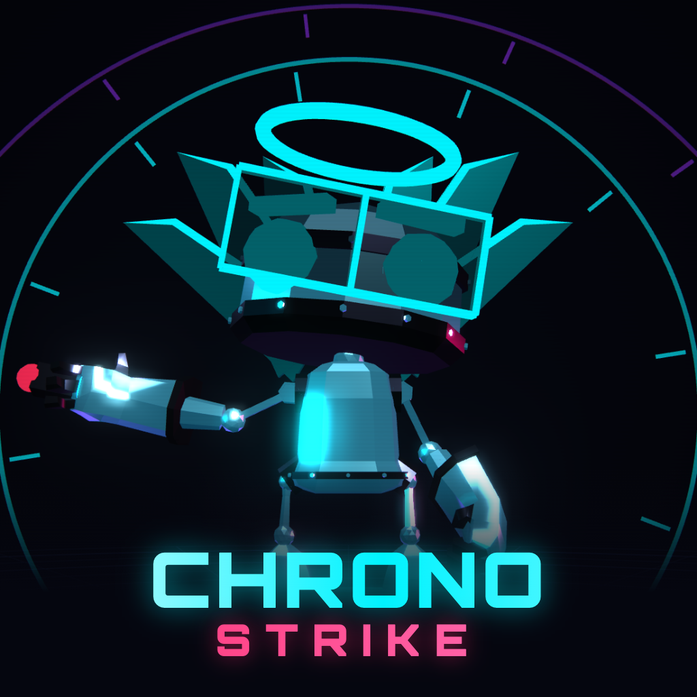
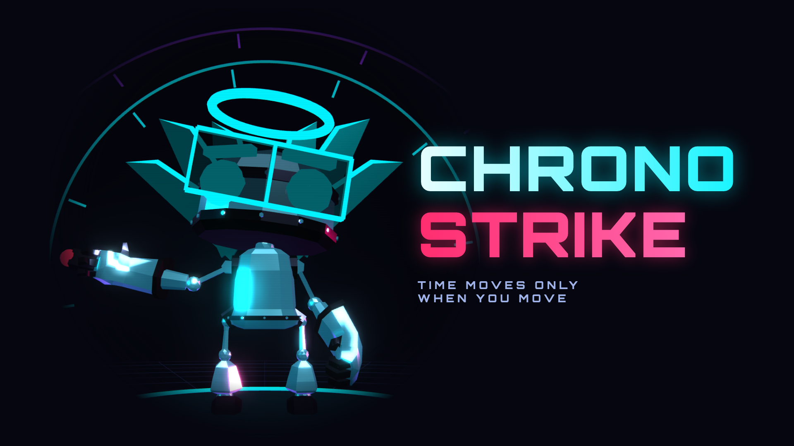
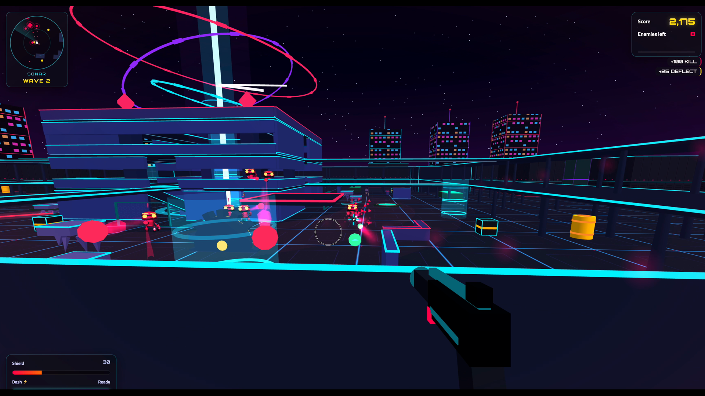
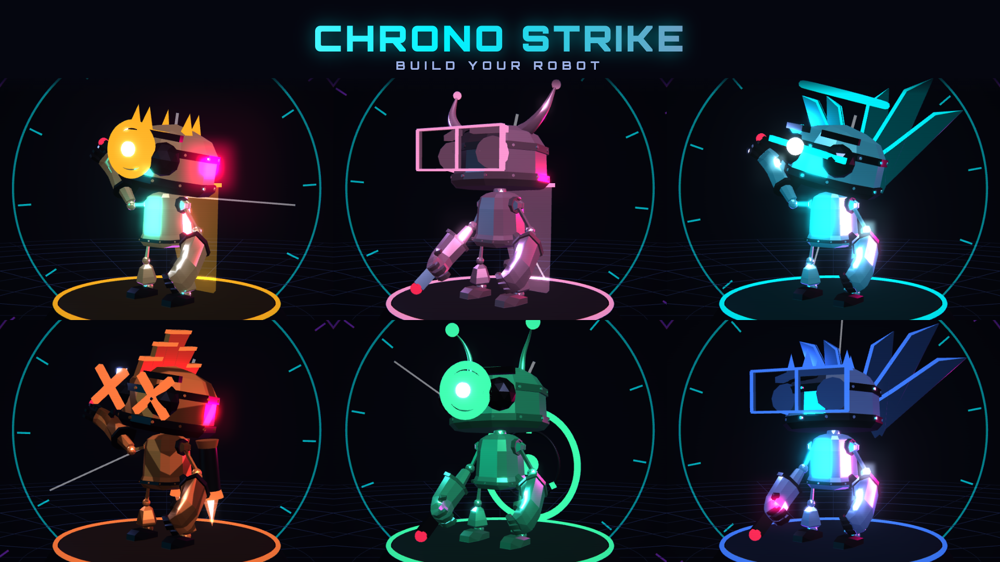
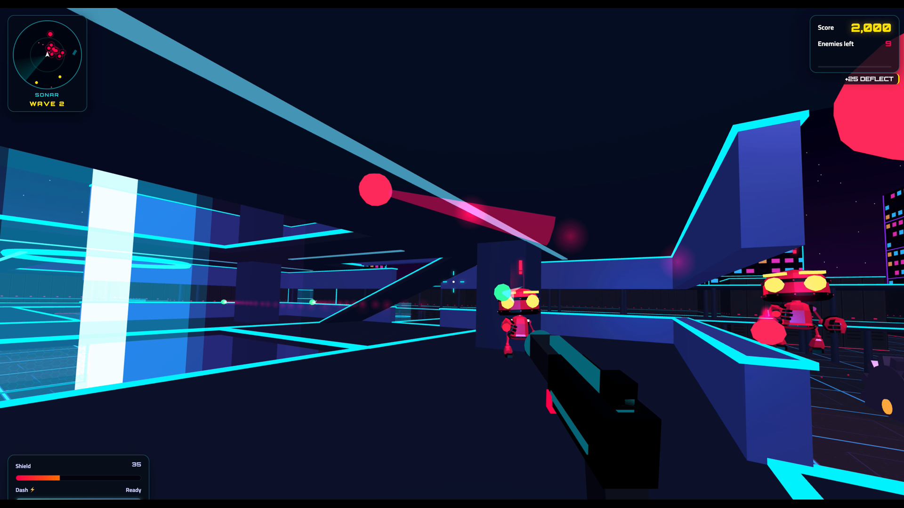
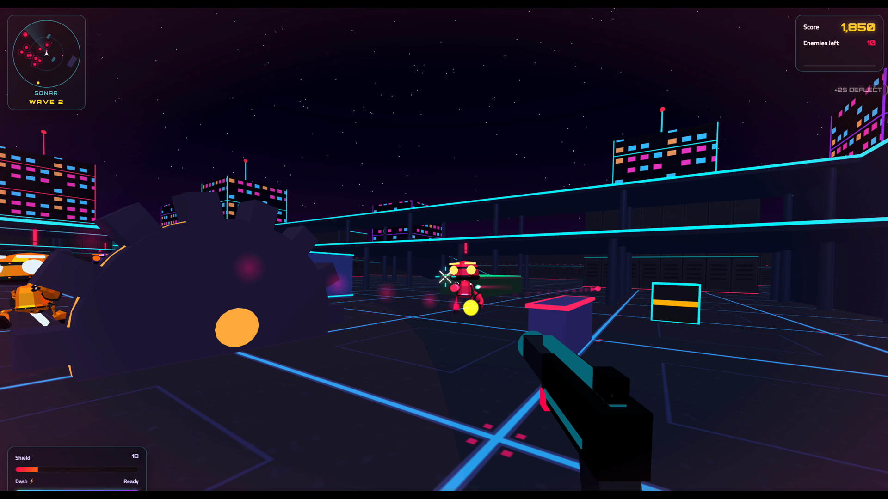

  

<h1 align="center">Chrono Strike</h1>

<b>A neon FPS where time only moves when you move.</b>

  <a href="https://eslamnegm.is-a.dev/chrono-maze/"><b>Play now in your browser</b></a>

  

Stand still and the world freezes: bullets hang in the air, robots stop mid-stride. Take a step and
everything rushes back to life. Fight waves of hunting robots solo, team up in online co-op (up to 4
players) or face friends in PvP time duels (up to 8). Free, no download, no account.

Desktop and mobile. 9 languages.

| Freeze the battlefield, then strike                   | Build your robot                                  |
| ----------------------------------------------------- | ------------------------------------------------- |
|  |  |
|      |  |

---

This repository only hosts the built game for GitHub Pages. The source code is private.

**All Rights Reserved © 2026 Chrono Strike.** No part of this game, its code, art or sound may be
copied, modified or redistributed without written permission.
