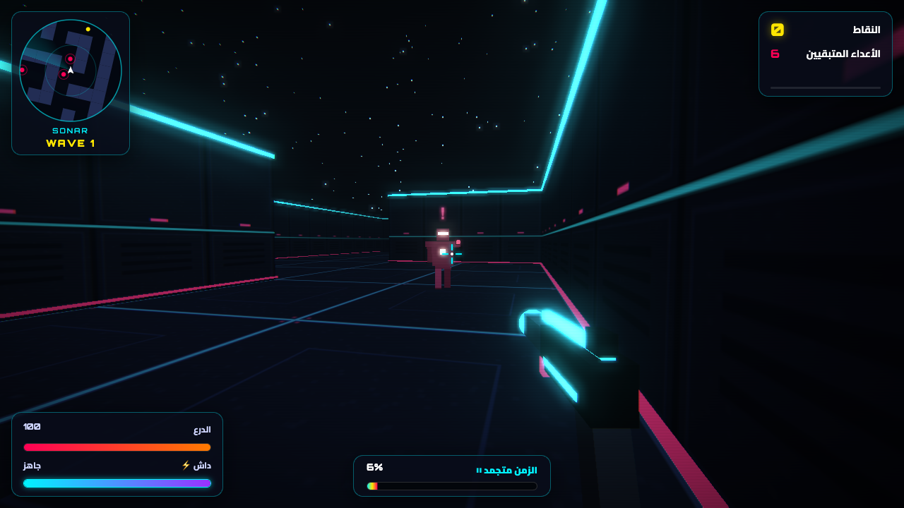
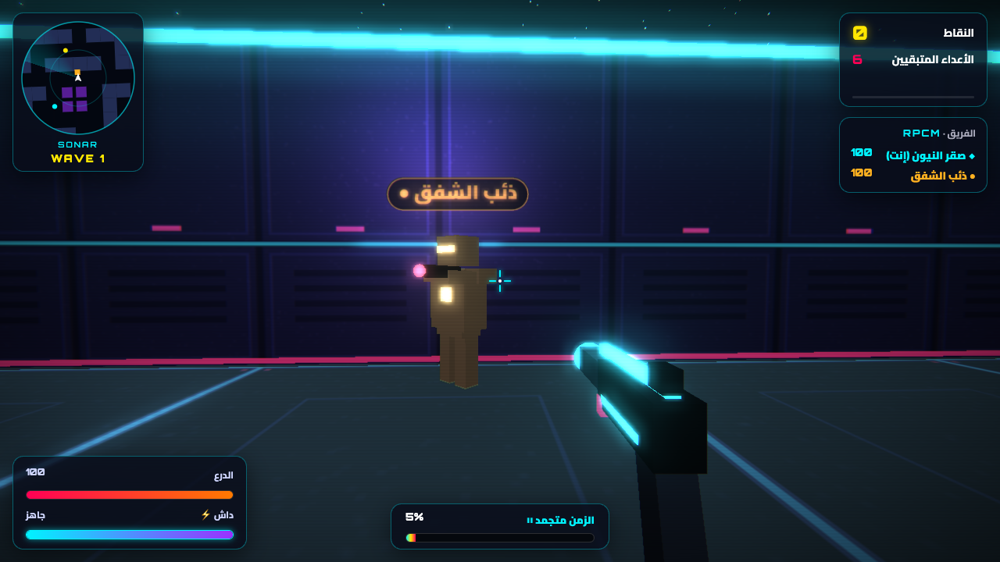
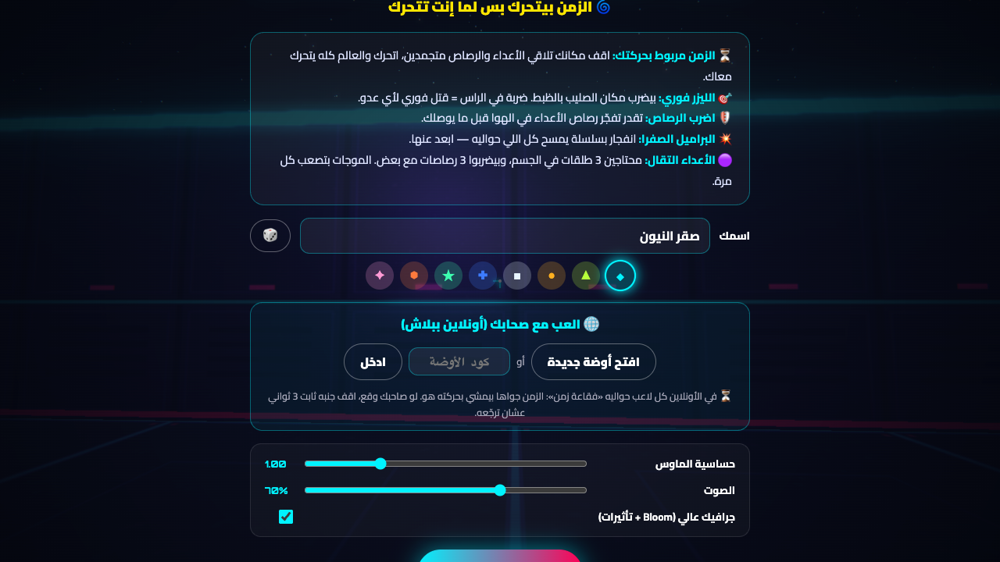

# Chrono-Maze 3D

A neon first-person shooter set in a cyber labyrinth, where **time only moves when you move**.
Stand still and enemy bullets freeze in mid-air. Move and the whole world speeds up with you.

### ▶ [Play now: eslamnegm.is-a.dev/chrono-maze](https://eslamnegm.is-a.dev/chrono-maze/)

Runs in the browser, no install. Play solo, or open a room and send the invite link to friends for online co-op (up to 4 players, free, no account).



| Online co-op: every player has a name, a colour and a time bubble | Main menu: name, colour, solo or online room |
| ----------------------------------------------------------------- | -------------------------------------------- |
|  |       |

Built with [three.js](https://threejs.org/) and [Vite](https://vitejs.dev/). The game ships no image or audio assets: textures are drawn on canvases at startup and every sound is synthesised with Web Audio.

## Quick start

```bash
nvm use            # Node 20 (see .nvmrc); Node ≥ 20.19 required
npm install
npm run dev        # http://localhost:5173
```

| Script            | What it does                                 |
| ----------------- | -------------------------------------------- |
| `npm run dev`     | Dev server with hot reload                   |
| `npm run build`   | Production build into `dist/`                |
| `npm run preview` | Serve the production build locally           |
| `npm test`        | Unit tests (Vitest)                          |
| `npm run lint`    | ESLint                                       |
| `npm run format`  | Prettier (write)                             |
| `npm run check`   | lint + test + build: run this before pushing |

Add `?debug` to the URL to expose the running game as `window.__game` in the console. It is always exposed in dev mode.

## Controls

| Input             | Action                                  |
| ----------------- | --------------------------------------- |
| `W A S D`         | Move (this is what makes time flow)     |
| Mouse / arrows    | Look                                    |
| Left click (hold) | Hitscan laser (headshot = instant kill) |
| `Shift`           | Dash (invulnerable while dashing)       |
| `Space`           | Jump                                    |
| `F` / right click | Throw the gun (kills anything it hits)  |
| `Esc` / `P`       | Pause                                   |
| `H`               | Toggle the controls panel               |

## Online co-op

- **Open a room** from the menu, then press `Esc` and copy the invite link (or share the 4-letter code). Friends who open the link land on the menu with the code filled in.
- **Time bubbles:** each player carries a bubble where time follows _their_ movement. Bullets and bots run at the speed of the bubble they are in, and outside every bubble time crawls at an ambient speed.
- **Down, not out:** at 0 shield you are knocked down. A teammate standing still next to you for 3 seconds revives you; clearing a wave revives everyone. The round ends when the whole team is down.
- **No server:** players connect peer to peer over WebRTC ([Trystero](https://github.com/dmotz/trystero) handles discovery over public networks). The room creator's browser is the host: it runs the bots, bullets and damage, and streams snapshots to the others. If the host leaves, the round ends.
- Add `?net=local` to test with two tabs of the same browser and no network.

## Deploying

The build is a static site with relative paths, so `dist/` can be hosted anywhere: GitHub Pages, Netlify, Vercel, itch.io, or an S3/CDN bucket.

**GitHub Pages (preconfigured):** push to `main`, then in the repo settings go to _Settings → Pages → Source_ and choose _GitHub Actions_. The workflow in `.github/workflows/deploy.yml` tests, builds and publishes on every push to `main`.

## Project layout

```
src/
  main.js              entry: validates the level, boots the Game
  config/              all data: levels, tuning numbers, enemy types, wave rosters
  core/                Game (composition root + state machine), math, geometry, settings
  world/               Grid (collision, raycasts, pathfinding), level validation, scene building, barrels
  entities/            Player, Enemy (AI), EnemyModel (mesh), RemotePlayers (other players' avatars)
  net/                 P2P transport (Trystero / BroadcastChannel) and the host-authoritative session
  systems/             Combat, EnemyManager, WaveDirector, projectiles, scoring, time dilation, time field, camera
  weapon/              first-person viewmodel
  render/              renderer + post-processing, shared GPU assets, procedural textures
  fx/                  particles, shards, tracers, explosions
  audio/               procedural sound synth
  input/               keyboard / mouse / pointer lock
  ui/                  HUD, radar, notifications, menus
  styles/              CSS
tests/                 unit tests for pure logic (grid, levels, math, settings, tuning, time bubbles, identity)
```

See [docs/ARCHITECTURE.md](docs/ARCHITECTURE.md) for how the pieces fit together and how to extend them (new levels, enemies, weapons).

The multiplayer roadmap (shared time fields, player identity, smarter bots, new modes) is in [docs/ROADMAP-MULTIPLAYER.md](docs/ROADMAP-MULTIPLAYER.md).

## Tech notes

- **three.js 0.160** is pinned exactly. Lights use physical units; the conversions from the game's original tuning live in `src/render/lights.js`.
- Colour management is turned off (`main.js`) because the palette was authored as raw neon values.
- Bloom and post-processing can be switched off in the menu for weaker GPUs. The game then renders directly, without the effect composer.
